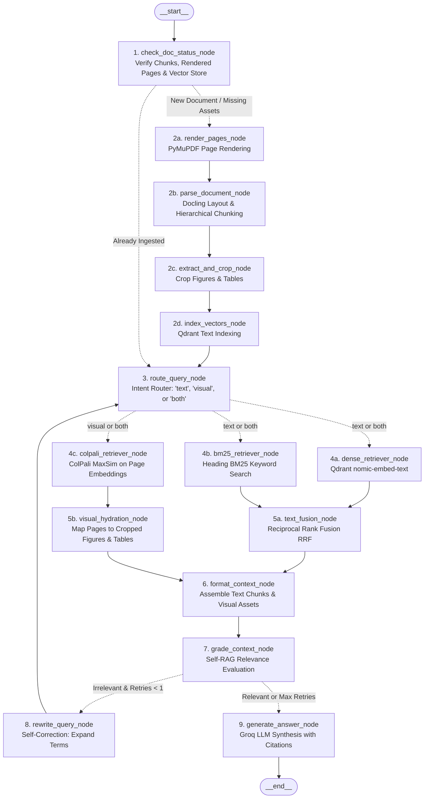

# Generalized Multi-Modal Agentic RAG System (LangGraph)

A production-grade, document-agnostic **Multi-Modal Agentic Retrieval-Augmented Generation (RAG)** system engineered to answer complex questions over any technical document containing written text, mathematical formulas, system architectures, flowcharts, diagrams, and tables (demonstrated on [*Attention Is All You Need*](data/raw/attention.pdf)).

Powered by **LangGraph**, this system orchestrates an adaptive, self-correcting state graph that intelligently routes queries, validates document relevance, reformulates ambiguous queries via internal **Self-RAG reflection**, and synthesizes grounded answers with verifiable page-level citations.

---

## Architecture Overview



---

## Key Capabilities

1. **Document-Agnostic Design**:
   - Works on **any PDF document** containing text and diagrams.
   - Dynamic document naming, automatic coordinate transformations, and generalized system prompts.
2. **LangGraph Agentic State Machine**:
   - **Typed State (`RAGState`)**: Maintains the active query, classification routes, candidate pools, retry counters, and verification flags.
   - **Adaptive Query Routing**: Bypasses heavy visual vision-language inference on purely textual questions, completing text-only queries in under 20 ms.
3. **Internal Self-RAG (Without Web Search)**:
   - Self-reflective relevance grading ensures the system evaluates whether retrieved passages genuinely contain the answer.
   - **Query Reformulation**: Translates colloquial queries into formal technical documentation vocabulary, looping back for a second retrieval attempt.
   - Avoids web search to eliminate external blog hallucinations and preserve strict page-level PDF provenance.
4. **True Visual Retrieval via ColPali (Option A)**:
   - Vision-language late-interaction multi-vector search (`pages_embeddings.pt`) discovers flowcharts, attention diagrams, and heatmaps directly from pixels.
   - Automatically maps top-ranked pages to cropped figures and structured Markdown tables.
5. **Single Qdrant Collection**:
   - Only one Qdrant collection (`research_papers` / `text_chunks`) is needed, simplifying deployment and vector storage.

---

## Repository Structure

```
RAG/
├── data/                                 # All persistent data assets (outside src/)
│   ├── graph.png                         # High-res offline visual diagram of LangGraph workflow
│   ├── graph.mmd                         # Mermaid graph definition exported from LangGraph
│   ├── raw/                              # Original source documents (e.g. attention.pdf)
│   ├── rendered_pages/                   # High-res 2x PNG page images (page_0001.png - page_0015.png)
│   ├── chunks/                           # JSONL text chunks, parsed documents, and metadata
│   ├── figures/                          # Cropped figure PNG images
│   ├── tables/                           # Cropped table PNG images
│   ├── embeddings/                       # ColPali multi-vector PyTorch embeddings (pages_embeddings.pt)
│   └── retrieval_runs/                   # Query run traces & diagnostic logs
│
├── notebooks/                            # Exploratory Jupyter notebooks
│   └── colpali_visual_retrieval.ipynb    # GPU ColPali embedding generation notebook
│
├── src/
│   ├── rag/                              # Core RAG package
│   │   ├── __init__.py
│   │   ├── config.py                     # Single source of truth for paths, models, & credentials
│   │   ├── doc_loader.py                 # PyMuPDF page rendering pipeline
│   │   ├── docling_parser.py             # IBM Docling layout parsing & hybrid chunking
│   │   ├── ingest.py                     # Unified multi-stage ingestion CLI pipeline
│   │   ├── retrieval_orchestrator.py     # Multimodal retrieval orchestrator & eval logging
│   │   ├── map_retrieval_results.py      # Result hydration & deduplication
│   │   ├── answer_generation.py          # Grounded multimodal LLM answer generation
│   │   ├── main.py                       # Main interactive application CLI entrypoint
│   │   │
│   │   ├── graph/                        # LangGraph Agentic RAG Subpackage
│   │   │   ├── __init__.py               # Exports app, build_rag_graph, run_agentic_rag, save_graph_artifacts
│   │   │   ├── state.py                  # Typed RAGState dictionary
│   │   │   ├── nodes.py                  # 15 modular nodes (ingestion, routing, dense, bm25, colpali, rrf, hydration, grade, rewrite, generate)
│   │   │   ├── workflow.py               # StateGraph compilation & conditional edge routing
│   │   │   └── visualize.py              # Graph artifact generation (data/graph.png & data/graph.mmd)
│   │   │
│   │   ├── text_retrieval/               # Text retrieval modules
│   │   │   ├── bm25_retriever.py         # Heading-aware Okapi BM25
│   │   │   ├── search_chunks.py          # Qdrant dense vector search
│   │   │   ├── index_chunks.py           # Text chunk indexer for Qdrant
│   │   │   └── hybrid_retriever.py       # Dense + BM25 Reciprocal Rank Fusion (RRF)
│   │   │
│   │   └── visual_retrieval/             # Visual & tabular retrieval modules
│   │       ├── colpali_model.py          # ColPali MultiVectorEncoder loader & MaxSim search
│   │       ├── preprocess/
│   │       │   ├── figure_extractor.py   # Extract figures & tables from Docling
│   │       │   ├── figure_cropper.py     # Crop figure regions from page images
│   │       │   ├── table_cropper.py      # Crop table regions from page images
│   │       │   └── caption_processor.py  # Caption cleaning, multi-panel grouping & filtering
│   │       └── search/
│   │           ├── colpali_retriever.py  # ColPali page-to-asset visual retriever (Option A)
│   │           └── hybrid_retrieval.py   # Orchestrator bridge for visual retrieval
│   │
│   └── services/
│       ├── __init__.py
│       └── llm_service.py                # Groq / LlamaIndex LLM provider
│
├── Decision.md                           # Architectural Decisions Record (ADR)
├── pyproject.toml                        # Project metadata & dependencies (managed by uv)
├── uv.lock                               # Deterministic dependency lockfile
└── README.md                             # Project documentation
```

---

## Getting Started

### Prerequisites

- **Python**: `>=3.14` (or `>=3.13` compatible environment)
- **Package Manager**: [`uv`](https://github.com/astral-sh/uv) (recommended)
- **Ollama**: Local Ollama instance running with `nomic-embed-text`:
  ```bash
  ollama pull nomic-embed-text
  ```
- **Qdrant**: Running Qdrant cluster (Cloud or local container)
- **Groq API**: An active Groq API key for LLM answer generation

---

### Installation & Environment Setup

1. **Install dependencies and register package**:
   ```bash
   uv sync
   uv pip install -e . --no-deps
   ```

2. **Configure environment variables**:
   Create a `.env` file in the project root:
   ```env
   GROQ_API=gsk_your_groq_api_key
   QDRANT_URL=https://your-qdrant-instance.cloud.qdrant.io:6333
   QDRANT_API_KEY=your_qdrant_api_key
   ```

---

## How to Run

### 1. Interactive LangGraph Assistant (Continuous Session)

Run the main application:
```bash
python -m rag.main
```
*(or simply: `uv run rag`)*

**Features**:
* **Persistent in-memory caching**: The ColPali model stays loaded in RAM across queries, answering subsequent questions in **~1–2 seconds**.
* **Self-RAG diagnostics**: Displays the classified intent (`ROUTE: Text / Visual / Both`) and any query reformulation performed.

*Example interaction:*
```text
Ask a question: Show me the diagram of scaled dot product attention

=======================================================
ROUTE: Visual | SELF-RAG RETRIES: 0
=======================================================
ANSWER:
Figure 2 (left) presents the Scaled Dot-Product Attention architecture [Source 1, Page 4].
The mechanism operates by taking queries (Q) and keys (K) of dimension dk, computing dot products,
scaling them by 1/sqrt(dk), and applying a softmax function to obtain attention weights for values (V)...

--- Sources ---
Source 1 [Figure] | ID: attention_fig_002 | Pages: 4
Source 2 [Figure] | ID: attention_fig_003 | Pages: 4
```

---

### 2. Visualize LangGraph Workflow Diagram

To generate and export the state machine graph visualization:

```bash
python -m rag.main --visualize
```
*(or run directly: `python -m rag.graph.visualize`)*

This inspects the compiled `StateGraph` and generates:
* **`graph.png`** / **`data/graph.png`**: Native LangGraph workflow PNG rendered via `get_graph().draw_mermaid_png()`.
* **`data/graph.mmd`**: Pure Mermaid syntax exported via `get_graph().draw_mermaid()` for documentation and Mermaid live viewers.

---

### 3. Ingest Any Technical Document

To ingest any PDF document containing text and diagrams:

```bash
python -m rag.ingest --pdf path/to/your_document.pdf
```

Optional flags:
- `--skip-rendering`: Skip rendering PDF pages if already extracted.
- `--skip-parsing`: Skip Docling layout parsing if chunks already exist.
- `--skip-cropping`: Skip visual figure and table image cropping.
- `--only-indexing`: Run only Qdrant vector indexing.

---

### 4. Pure Retrieval Diagnostics (Without Calling LLM)

To inspect retrieval rankings and save evaluation traces to `data/retrieval_runs/`:

```bash
python -m rag.retrieval_orchestrator
```

---

## Architectural Decision Records (ADR)

For detailed documentation on every architectural, algorithmic, and engineering decision, refer to:
👉 **[`Decision.md`](Decision.md)**

---

## License

This project is licensed under the [MIT License](LICENSE).
