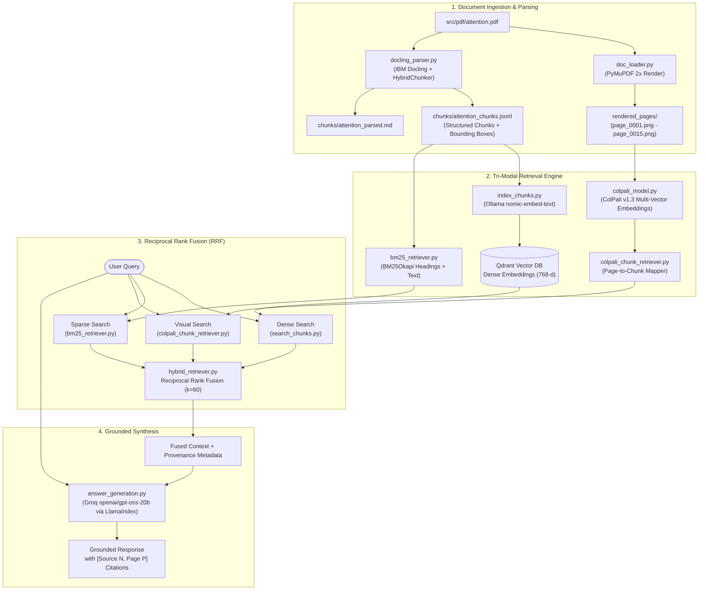

# Multi-Modal Hybrid RAG System

A production-grade, multi-modal Retrieval-Augmented Generation (RAG) pipeline designed for complex technical documents and research papers (demonstrated on [*Attention Is All You Need*](src/pdf/attention.pdf)).

This system combines **document layout parsing**, **visual late-interaction retrieval (ColPali)**, **dense semantic vector search (Qdrant + Ollama)**, and **sparse heading-aware lexical retrieval (BM25)** fused via **Reciprocal Rank Fusion (RRF)**, culminating in **Groq-accelerated LLM answer generation** with verifiable page-level source citations.

---

## Architecture Overview



---

## Key Features

1. **Structured Layout & Vision Parsing**:
   - **PyMuPDF (`pymupdf`)**: Extracts high-DPI (2x scale matrix) page images to preserve visual layout, figures, and tables.
   - **IBM Docling (`docling`)**: Parses PDF structure into hierarchical markdown and contextualized JSONL chunks, retaining exact bounding box coordinates, headings, page provenance, and document item types.

2. **Tri-Modal Hybrid Search Engine**:
   - **Dense Semantic Retrieval**: Embeds chunks using Ollama's `nomic-embed-text` (768-dimensional vectors) and stores them with deterministic UUID5 identifiers in a **Qdrant** collection (`research_papers`).
   - **Sparse Heading-Aware Lexical Retrieval**: Custom tokenization and BM25 Okapi scoring prioritizing document headings over raw body text for targeted technical keyword lookup.
   - **Visual Multi-Vector Retrieval (ColPali v1.3)**: Uses `vidore/colpali-v1.3-hf` late-interaction multi-vector representations to match queries directly against visual page images (capturing equations, architecture diagrams, and tables), then maps page ranks down to text chunks.
   - **Reciprocal Rank Fusion (RRF)**: Merges ranked candidate lists across dense, sparse, and visual retrieval paradigms using the rank formula:
     $$\text{RRF Score}(d) = \sum_{m \in M} \frac{1}{k + r_m(d)} \quad (k = 60)$$

3. **Grounded Answer Synthesis with Citations**:
   - Context is assembled with explicit source IDs and page numbers.
   - High-throughput LLM reasoning via **Groq** (`openai/gpt-oss-20b`) orchestrated using **LlamaIndex**.
   - Guardrailed against hallucinations: answers must be supported by the provided context and cited as `[Source N, Page P]`.

4. **Rigorous Offline Benchmark Suite**:
   - Includes a manually verified golden dataset of 23 queries (`golden_set.json`) targeting specific concepts in the Transformer paper.
   - Computes standard information retrieval metrics: **Precision@K**, **Recall@K**, **MRR@K** (Mean Reciprocal Rank), and **Hit Rate@K**.

---

## Empirical Retrieval Benchmark

Evaluated against `src/evaluation/golden_set.json` (23 questions, $K=5$):

| Retriever | Precision@5 | Recall@5 | MRR@5 | Hit Rate@5 |
| :--- | :---: | :---: | :---: | :---: |
| **Dense (Qdrant + nomic-embed-text)** | **0.3478** | **0.7616** | **0.8514** | **91.30%** |
| **Sparse (Heading-Aware BM25)** | 0.3217 | 0.7036 | 0.7101 | 82.61% |
| **Hybrid (RRF Fusion)** | **0.3478** | 0.7558 | 0.7971 | 86.96% |

> Detailed query-level results are stored in [`src/evaluation/results_at_5.json`](src/evaluation/results_at_5.json).

---

## Repository Structure

```
.
├── src/
│   ├── data/
│   │   └── colpali/
│   │       └── attention_colpali.pt    # Precomputed ColPali multi-vector page embeddings
│   ├── evaluation/
│   │   ├── evaluate.py                 # Evaluation runner (P@K, R@K, MRR@K, HitRate@K)
│   │   ├── golden_set.json             # 23 labeled benchmark QA pairs with ground-truth chunks
│   │   └── results_at_5.json           # Evaluation metrics output
│   ├── notebook/
│   │   └── colpali_visuval_retrieval.ipynb  # Colab notebook for rendering & ColPali multi-vector indexing
│   ├── pdf/
│   │   ├── attention.pdf               # Source document ("Attention Is All You Need")
│   │   ├── rendered_pages/             # Rendered 2x PNG page images (page_0001.png - page_0015.png)
│   │   ├── rendered_pages.zip          # Zipped page images archive
│   │   └── chunks/
│   │       ├── attention_chunks.jsonl  # Contextualized Docling chunks with metadata & bboxes
│   │       └── attention_parsed.md     # Extracted markdown representation
│   ├── rag/
│   │   ├── __init__.py
│   │   ├── doc_loader.py               # PyMuPDF page rendering pipeline
│   │   ├── docling_parser.py           # IBM Docling conversion & hybrid chunker
│   │   ├── index_chunks.py             # Qdrant vector indexer using Ollama embeddings
│   │   ├── search_chunks.py            # Standalone Qdrant dense vector search
│   │   ├── bm25_retriever.py           # Heading-aware BM25 lexical retriever
│   │   ├── colpali_model.py            # MultiVectorEncoder ColPali loader & similarity search
│   │   ├── colpali_chunk_retriever.py  # Maps ColPali page ranking to document chunks
│   │   ├── hybrid_retriever.py         # Tri-modal Reciprocal Rank Fusion (RRF)
│   │   ├── answer_generation.py        # End-to-end grounded generation with citations
│   │   └── test_colpali.py             # ColPali retrieval latency & inference verification
│   └── services/
│       └── llm_service.py              # Groq LLM client initialized via LlamaIndex
├── .env                                # Environment variables (API keys, endpoints)
├── pyproject.toml                      # Project metadata and dependencies (managed by uv)
├── uv.lock                             # Pinned lockfile
└── README.md                           # Project documentation
```

---

## Getting Started

### Prerequisites

- **Python**: `>=3.14` (or `>=3.13` compatible environment)
- **Package Manager**: [`uv`](https://github.com/astral-sh/uv) (recommended) or `pip`
- **Ollama**: Local Ollama instance running with `nomic-embed-text` pulled:
  ```bash
  ollama pull nomic-embed-text
  ```
- **Qdrant**: A running Qdrant cluster (Cloud or local Docker container)
- **Groq API**: An active Groq API key for LLM answer generation
- **CUDA (Optional)**: Recommended for accelerating ColPali visual multi-vector inference (falls back to CPU automatically)

---

### Installation & Environment Setup

1. **Clone the repository and install dependencies**:
   ```bash
   uv sync
   ```

2. **Configure environment variables**:
   Create a `.env` file in the project root:
   ```env
   GROQ_API=gsk_your_groq_api_key
   QDRANT_URL=https://your-qdrant-instance.cloud.qdrant.io:6333
   QDRANT_API_KEY=your_qdrant_api_key
   ```

---

## Step-by-Step Execution Pipeline

### 1. Render Document Pages to Images
Renders high-resolution PNG images from the input PDF for ColPali visual embedding:
```bash
python src/rag/doc_loader.py
```
*Output: `src/pdf/rendered_pages/page_0001.png` through `page_0015.png`*

### 2. Parse and Chunk PDF with Docling
Extracts structural elements, bounding boxes, headings, and contextualized text:
```bash
python src/rag/docling_parser.py
```
*Output: `src/pdf/chunks/attention_chunks.jsonl` and `attention_parsed.md`*

### 3. Generate ColPali Visual Embeddings (Optional / Precomputed)
Visual embeddings can be generated via the Colab notebook [`src/notebook/colpali_visuval_retrieval.ipynb`](src/notebook/colpali_visuval_retrieval.ipynb) or locally. The precomputed embeddings for the paper are already saved at:
```
src/data/colpali/attention_colpali.pt
```
Verify the ColPali model and precomputed embeddings:
```bash
python src/rag/test_colpali.py
```

### 4. Index Dense Chunks into Qdrant
Generates 768-dimensional embeddings via Ollama and upserts points into Qdrant:
```bash
python src/rag/index_chunks.py
```

### 5. Run Hybrid Retrieval (Dense + BM25 + ColPali)
Executes all three retrievers and fuses results via RRF:
```bash
python src/rag/hybrid_retriever.py
```

### 6. End-to-End Answer Generation
Ask a question, retrieve fused context, and receive a grounded response with page-level citations:
```bash
python src/rag/answer_generation.py
```

*Example Output:*
```text
Ask a question about the paper: How does Multi-Head Attention work and why is it beneficial?

--- Answer ---
Multi-Head Attention projects the queries, keys, and values h times with different,
learned linear projections to dk, dk, and dv dimensions, respectively. On each of these
projected versions of queries, keys, and values, the attention function is performed in parallel,
yielding dv-dimensional output values. These are concatenated and once again projected... [Source 1, Page 5]

--- Sources ---
Source 1 | Page 5
Source 2 | Page 4
Source 3 | Page 6
```

---

## Running Evaluation Benchmarks

To evaluate retrieval performance against the golden benchmark dataset:

```bash
python src/evaluation/evaluate.py --top-k 5
```

Optional arguments:
- `--top-k`: Number of documents to retrieve per metric evaluation (default: `5`).
- `--golden`: Path to custom golden dataset JSON (default: `src/evaluation/golden_set.json`).

---

## Tech Stack Summary

| Layer | Technology | Purpose |
| :--- | :--- | :--- |
| **Document Processing** | [IBM Docling](https://github.com/DS4SD/docling) | Layout-aware parsing, hierarchical chunking & bounding box provenance |
| **Image Extraction** | [PyMuPDF (fitz)](https://github.com/pymupdf/PyMuPDF) | High-resolution PDF page rendering |
| **Visual Retrieval** | [ColPali v1.3](https://huggingface.co/vidore/colpali-v1.3-hf) (`sentence-transformers`) | Late-interaction vision-language multi-vector retrieval |
| **Dense Embeddings** | [Ollama](https://ollama.com/) (`nomic-embed-text`) | Local 768-dimensional semantic text embeddings |
| **Vector Database** | [Qdrant](https://qdrant.tech/) (`qdrant-client`) | Vector indexing, payload storage, and similarity search |
| **Lexical Search** | [Rank-BM25](https://github.com/dorianbrown/rank_bm25) | Heading-weighted Okapi BM25 keyword matching |
| **Fusion Algorithm** | Reciprocal Rank Fusion (RRF) | Multi-system rank fusion with constant $k=60$ |
| **LLM Inference** | [Groq](https://groq.com/) via [LlamaIndex](https://www.llamaindex.ai/) | Ultra-low latency generation with strict citation prompt |
| **Packaging & Env** | [uv](https://github.com/astral-sh/uv) | Python virtual environment and dependency lockfile |

---

## License

This project is licensed under the [MIT License](LICENSE).
