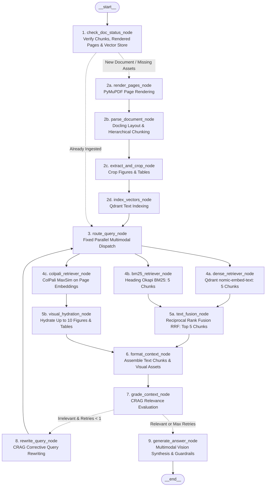

# Generalized Multi-Modal Agentic RAG System (LangGraph)

A production-grade, document-agnostic **Multi-Modal Agentic Retrieval-Augmented Generation (RAG)** system engineered to answer complex questions over any technical document containing written text, mathematical formulas, system architectures, flowcharts, diagrams, and tables (demonstrated on [*Attention Is All You Need*](data/raw/attention.pdf)).

Powered by **LangGraph**, this system orchestrates an adaptive, self-correcting state graph that executes parallel dense and lexical retrieval, late-interaction visual page discovery via **ColPali**, evaluates relevance via **Corrective RAG (CRAG)**, and synthesizes grounded answers with verifiable page-level citations—all delivered through an interactive, distraction-free **Laboratory Notebook Web Workspace**.

---

## Architecture Overview



---

## Key Capabilities

1. **Document-Agnostic Design**:
   - Ingests and queries **any PDF document** containing text, mathematical proofs, diagrams, and tables.
   - Dynamic document namespacing, automated coordinate mapping, and generalized multimodal context formatting.

2. **Balanced Multimodal Retrieval (Calibrated Depth)**:
   - **Dense Retrieval**: Retrieves **5 candidate text chunks** using Qdrant and `nomic-embed-text`.
   - **Lexical Retrieval**: Retrieves **5 candidate heading chunks** using Okapi BM25.
   - **Reciprocal Rank Fusion (RRF)**: Fuses both candidate streams ($k=60$) to select the **top 5 text chunks**.
   - **Visual Asset Discovery**: ColPali multi-vector late-interaction MaxSim discovers top visual pages, hydrating **up to 10 visual assets** (cropped figures and structured Markdown tables) with full caption metadata.

3. **Deterministic Unanswerable Guardrails**:
   - If a question falls outside the document corpus (e.g. *"what is random forest?"* on an attention paper), the system prompt and deterministic server-side classifier enforce an immediate, clean response:
     ```
     I don't have information about that in the document.
     ```
   - **Zero Meta-Clutter**: Completely eliminates verbose explanations (*"The provided text chunks exclusively discuss..."*).
   - **Source Purging**: Automatically clears context sources (`sources = []`) so no irrelevant figure mounts or citation bars appear.

4. **Corrective RAG (CRAG) Without Web Hallucination**:
   - **Evaluator Grader Node**: Assesses whether retrieved multimodal passages contain facts or formulas useful to answer the query.
   - **Corrective Query Transformation**: If context is insufficient, reformulates the query into formal technical vocabulary and retries retrieval.
   - Strictly bounded to document ground truth—eliminates external web hallucination.

5. **Direct Multimodal Vision Generation (`llm_vision`)**:
   - Powered by `qwen/qwen3.8-27b` on Groq.
   - Passes text chunks, structured Markdown tables, and cropped figure PNGs directly into the vision model.
   - Includes **self-healing token protection**: automatically truncates oversized table grids and retries with pure text/table markdown if vision token ceilings are encountered.

6. **Interactive Laboratory Notebook Web Workspace**:
   - **Monochrome Sketchy Aesthetic**: Clean, high-contrast research atmosphere with ruled borders, `Source Serif 4` prose, and `EB Garamond` headers.
   - **Side-by-Side Inspection**: Split-view document viewer with high-res page rendering, zoom controls, thumbnail strip, and native PDF toggle.
   - **Progressive Typewriter Streaming**: Word-by-word streaming animation with a blinking cursor.
   - **Local KaTeX Typesetting**: 100% offline mathematical formula rendering (`$$...$$` blocks and `$...$` inlines).
   - **Consolidated Provenance Bar**: Interactive `Sources: Page 10, 12, 15...` pills that open the viewer and jump to the exact page.
   - **Persistent Conversational Memory**: LangGraph `SqliteSaver` checkpoints in `data/chat_history.db` preserve dialogues across reloads.
   - **Granular Session Control**: One-click **"Clear Chat"** button permanently resets the SQLite conversation state for the active document.
   - **Self-Healing Visual Assets**: Canonical asset URL resolution (`/data/figures/...`, `/data/tables/...`) with automatic client-side fallback.
   - **Real-Time Ingestion Progress Bar**: Multi-stage animated loading bar with live percentage, stage telemetry (page rendering, Docling layout parsing, visual cropping, vector indexing), and a persistent top-strip progress banner.

---

## Retrieval Calibration Reference

| Retrieval Stage | Default Count | Purpose & Mechanism |
| :--- | :--- | :--- |
| **Dense Search** | **5 chunks** | Semantic vector search via Qdrant (`nomic-embed-text`) |
| **BM25 Search** | **5 chunks** | Lexical keyword search over chunk section headings |
| **RRF Fusion** | **5 chunks** | Reciprocal Rank Fusion ($k=60$) combining Dense + BM25 |
| **ColPali Pages** | **5 pages** | Late-interaction MaxSim discovery on rendered page embeddings |
| **Figures + Tables** | **Up to 10 assets** | Cropped figures (PNGs) and tables (Markdown grids) from top pages |
| **Total Context** | **Up to 15 assets** | Grounded multimodal evidence delivered to the VLM |

---

## Repository Structure

```
RAG/
├── backend/                              # Backend application service
│   ├── server.py                         # FastAPI web server, REST endpoints, & asset URL resolver
│   └── src/
│       ├── rag/                          # Core RAG package
│       │   ├── __init__.py
│       │   ├── config.py                 # Single source of truth for paths, models, & retrieval limits
│       │   ├── doc_loader.py             # PyMuPDF page rendering pipeline
│       │   ├── docling_parser.py         # IBM Docling layout parsing & hierarchical chunking
│       │   ├── document_manager.py       # Multi-document listing and deletion utilities
│       │   ├── ingest.py                 # Multi-stage automated ingestion CLI pipeline
│       │   ├── main.py                   # Interactive CLI chat assistant
│       │   │
│       │   ├── graph/                    # LangGraph Agentic RAG Subpackage
│       │   │   ├── __init__.py           # Exports app, build_rag_graph, run_agentic_rag
│       │   │   ├── state.py              # Typed RAGState dictionary definition
│       │   │   ├── nodes.py              # Ingestion, retrieval, RRF, hydration, CRAG, VLM synthesis & guardrails
│       │   │   ├── workflow.py           # StateGraph compilation, SQLite checkpointer, & conditional edges
│       │   │   └── visualize.py          # StateGraph Mermaid visualization exporter
│       │   │
│       │   ├── text_retrieval/           # Text retrieval modules
│       │   │   ├── bm25_retriever.py     # Heading-aware Okapi BM25 retriever
│       │   │   ├── search_chunks.py      # Qdrant dense vector search
│       │   │   ├── index_chunks.py       # Text chunk indexing pipeline for Qdrant
│       │   │   └── hybrid_retriever.py   # Dense + BM25 Reciprocal Rank Fusion (RRF)
│       │   │
│       │   └── visual_retrieval/         # Visual & tabular retrieval modules
│       │       ├── colpali_client.py     # ColPali Hugging Face ZeroGPU API client
│       │       ├── colpali_model.py      # ColPali multi-vector retriever loader
│       │       ├── preprocess/
│       │       │   ├── figure_extractor.py   # Extract figure/table bounding boxes from Docling
│       │       │   ├── figure_cropper.py     # Crop figure regions into PNG images
│       │       │   ├── table_cropper.py      # Crop table regions into PNG images
│       │       │   └── caption_processor.py  # Caption cleaning & panel grouping
│       │       └── search/
│       │           └── colpali_retriever.py  # ColPali visual retriever & asset hydration
│       │
│       └── services/
│           ├── __init__.py
│           └── llm_service.py            # Groq LLM & VLM providers (Qwen 3.8 27B / GPT-OSS-20B)
│
├── frontend/                             # Client Web Application (Presentation Layer)
│   └── static/                           # Monochrome / Sketchy web client
│       ├── index.html                    # Clean research canvas & side-by-side inspector
│       ├── style.css                     # Monochrome design system tokens, typography & layout
│       ├── app.js                        # Client state, streaming typewriter, KaTeX rendering, & viewer
│       └── vendor/
│           └── katex/                    # 100% offline local KaTeX mathematical engine
│
├── data/                                 # Persistent data assets
│   ├── chat_history.db                   # SQLite database storing multi-document conversation checkpoints
│   ├── raw/                              # Original source PDF documents (e.g. attention.pdf)
│   ├── rendered_pages/                   # High-res 2x PNG page images (page_0001.png - page_0015.png)
│   ├── chunks/                           # JSONL text chunks, parsed documents, and table/figure metadata
│   ├── figures/                          # Cropped figure PNG images
│   ├── tables/                           # Cropped table PNG images
│   ├── embeddings/                       # ColPali multi-vector PyTorch embeddings (pages_embeddings.pt)
│   ├── graph.png                         # High-res visual diagram of compiled LangGraph workflow
│   └── graph.mmd                         # Mermaid graph definition exported from LangGraph
│
├── Decision.md                           # Architectural Decisions Record (ADR: Decisions 1–32)
├── pyproject.toml                        # Central project metadata & dependencies (managed by uv)
├── uv.lock                               # Deterministic dependency lockfile
└── README.md                             # Central project documentation
```

---

## Getting Started

### Prerequisites

- **Python**: `>=3.14` (or `>=3.13` compatible environment)
- **Package Manager**: [`uv`](https://github.com/astral-sh/uv) (recommended)
- **Ollama**: Running instance with `nomic-embed-text`:
  ```bash
  ollama pull nomic-embed-text
  ```
- **Qdrant**: Running Qdrant cluster (Cloud or local container)
- **Groq API**: An active Groq API key for LLM and VLM inference

---

### Installation & Environment Setup

1. **Install dependencies and register package**:
   ```bash
   uv sync
   uv pip install -e . --no-deps
   ```

2. **Configure environment variables**:
   Create a `.env` file in the project root:
   ```env
   GROQ_API=gsk_your_groq_api_key
   QDRANT_URL=https://your-qdrant-instance.cloud.qdrant.io:6333
   QDRANT_API_KEY=your_qdrant_api_key
   ```

---

## How to Run

### 1. Interactive Web Research Workspace (Recommended)

Start the FastAPI application:
```bash
python backend/server.py
```
*(or via uvicorn directly: `uvicorn backend.server:app --reload --port 8000`)*

Open your browser to:
👉 **`http://localhost:8000`**

**Features**:
* **Side-by-Side Document Inspection**: Read answers while inspecting original document pages, diagrams, and native PDFs.
* **Progressive Typewriter Streaming**: Word-by-word streaming effect with interactive instant-skip on click.
* **Mathematical Typography**: Rendered offline via KaTeX with standard LaTeX formatting.
* **Multi-Document Memory**: Switch seamlessly between documents with isolated conversation history restored automatically from SQLite.
* **Clear Chat**: Reset dialogue checkpoints for the active document with a single click.

---

### 2. Interactive CLI Assistant (Continuous Terminal Session)

To chat directly in the terminal:
```bash
python -m rag.main
```
*(or simply: `uv run rag`)*

*Example interaction:*
```text
Ask a question: Show me the diagram of scaled dot product attention

=======================================================
ROUTE: Both | CRAG RETRIES: 0
=======================================================
ANSWER:
Figure 2 (left) presents the Scaled Dot-Product Attention architecture [Source 1, Page 4].
The mechanism operates by taking queries (Q) and keys (K) of dimension dk, computing dot products,
scaling them by 1/sqrt(dk), and applying a softmax function to obtain attention weights for values (V)...

--- Sources ---
Source 1 [Figure] | ID: attention_fig_002 | Pages: 4
Source 2 [Figure] | ID: attention_fig_003 | Pages: 4
```

---

### 3. Ingest Any Technical PDF

To ingest a new PDF document (automated Docling parsing, chunking, visual asset cropping, and Qdrant indexing):

```bash
python -m rag.ingest --pdf path/to/your_document.pdf
```

Optional ingestion flags:
- `--skip-rendering`: Skip rendering PDF pages if images already exist.
- `--skip-parsing`: Skip Docling layout parsing if chunks already exist.
- `--skip-cropping`: Skip visual figure and table image cropping.
- `--only-indexing`: Run only Qdrant vector indexing.

*(Documents can also be uploaded directly via the **"+ Upload Document"** button in the Web UI).*

---

### 4. Visualize LangGraph Workflow Diagram

To export an updated visualization of the state machine graph:

```bash
python -m rag.main --visualize
```
*(or run directly: `python -m rag.graph.visualize`)*

Generates:
* **`data/graph.png`**: High-resolution workflow PNG diagram.
* **`data/graph.mmd`**: Pure Mermaid flowchart definition.

---

### 5. Pure Retrieval Diagnostics (Without Calling LLM)

To evaluate retrieval rankings independently:

* **ColPali Visual Search**:
  ```bash
  python -m rag.visual_retrieval.search.colpali_retriever
  ```
* **Dense + BM25 Hybrid Fusion (RRF)**:
  ```bash
  python -m rag.text_retrieval.hybrid_retriever
  ```

---

## Architectural Decision Records (ADR)

For detailed documentation on every architectural, algorithmic, and engineering decision (Decisions 1 through 32), refer to:
👉 **[`Decision.md`](Decision.md)**

---

## License

This project is licensed under the [MIT License](LICENSE).
